# QCU Student Planner

[](LICENSE)


QCU Student Planner is a web app where Quezon City University students keep their class schedule, tasks, notes, grades and attendance in one place. It also has AI tools that generate quizzes and flashcards and answer study questions. It runs in the browser and can be installed as a Progressive Web App.

> QCU Student Planner is an independent student-developed project and is not an official system of or affiliated with Quezon City University (QCU). The application is designed to assist students with academic organization, planning, and productivity. It is not a substitute for official university services, announcements, or academic records.

## Contents

- [About](#about)
- [Features](#features)
- [Screenshots](#screenshots)
- [Technology stack](#technology-stack)
- [Getting started](#getting-started)
- [Project structure](#project-structure)
- [Configuration reference](#configuration-reference)
- [Database and security](#database-and-security)
- [Contributing](#contributing)
- [Deployment](#deployment)
- [Known limitations](#known-limitations)
- [Additional documentation](#additional-documentation)
- [Disclaimer](#disclaimer)
- [License](#license)

## About

Students track classes, deadlines, grades and attendance in separate apps, spreadsheets and paper notes. The planner keeps them in one account, calculates GWA and attendance rates from what the student enters, and adds AI tools for studying. New accounts are reviewed by an administrator before they can use the app.

It is built for three groups:

- **Students** who use the planner day to day.
- **Administrators** who approve accounts, send messages to students and handle support tickets.
- **Contributors** who maintain and extend the codebase.

## Features

Everything listed under Students and Administrators is implemented. Pages that exist but show a "coming soon" notice are listed separately at the end.

### Accounts and access

- Registration with email and password through a multi-step form (name, email, password, program, campus, year level).
- Sign in with Google. Google users who are missing profile details finish them on a "finish profile" page.
- Email confirmation links, forgot password and reset password pages.
- Every new account starts as pending. A pending account sees a waiting page until an administrator approves or rejects it. Rejected accounts see the rejection reason. Suspended accounts are blocked.

### Students

- **Dashboard.** Greeting and clock, semester progress (current week, weeks left, progress bar), summary cards for subjects, GWA, attendance and tasks, a grade performance chart, an attendance breakdown, today's schedule and upcoming tasks.
- **Schedule.** Manage subjects with day, list and timetable views. The timetable has adjustable zoom, and subjects can be archived.
- **Tasks and deadlines.** Filter and group tasks, select several at once, switch between list and board views, and add checklist items to a task.
- **Notes.** Rich-text editor with a formatting toolbar, headings, lists and checklists. Notes can be favorited, filtered, bulk-edited and linked to a subject or task.
- **Calendar.** Month, week and day views with filters for classes, tasks, events and university dates.
- **Grades and GWA.** Enter grade components and assessments per subject. Percentages convert to the 1.00 to 5.00 scale, and the app computes your GWA.
- **Attendance.** Record Present, Late, Excused and Absent per class date. Shows per-subject rates, an absence limit (3 by default) and a heatmap.
- **Curriculum reference.** A PDF viewer with page navigation, zoom and rotation for the curricula of BSA, BS Entrepreneurship, BSECE, BSIE, BSIT, BSIS, BSCS and BECEd.
- **AI Study Assistant.** Chat that keeps your conversation history. You can attach a PDF, JPG or PNG (up to 8 MB), and replies render with Markdown formatting.
- **AI Quiz Maker.** Generates a quiz from a topic, pasted notes or an attached file. You pick the number of questions and Easy, Medium or Hard difficulty. Quizzes and your attempts are saved.
- **AI Flashcard Maker.** Generates a flashcard deck from a topic, notes or an attached file. Decks are saved.
- **Notifications and Inbox.** The notifications page lists reminders with filters, and read state is stored on the device. The inbox shows messages from administrators. It is read-only, so students cannot reply.
- **Reports.** Submit a support ticket to the administrators and follow its status.
- **Help center.** Searchable help topics.
- **Wallpaper generator.** Creates schedule wallpapers from your classes in 8 themes.
- **Settings and themes.** Edit your profile, choose Dark, Light or AMOLED, pick from 14 accent colors, toggle notifications (upcoming class, assignment due, exam reminders), manage semesters, and export or import a JSON backup of your data. Settings also shows the sync status and the install button.
- **Progressive Web App.** Includes a web manifest, icons and a service worker. Pages, scripts and styles load from the network first and fall back to cached copies. Images, icons and CDN files are cached first. Auth and admin pages are never cached. Installation is offered from Settings. Planner data needs a connection to Supabase to sync.

### Administrators

- **Dashboard** with charts for account status, registrations over time, accounts by program and accounts by campus.
- **Pending approvals.** Approve or reject applications with a reason. The page also shows whether an applicant's email follows the expected student email format.
- **Users.** Search and filter accounts, and approve, reject, suspend or reactivate them.
- **Rejected accounts.** Review rejected accounts and permanently delete them after a typed confirmation. Deletion runs through a Supabase Edge Function.
- **Inbox.** Send one-way messages to students and archive them.
- **Tickets.** Review support tickets, change their status and add internal notes.
- **Activity log.** Read-only audit log of administrator actions.

### Not implemented yet

- Legal and Policies page (coming-soon notice).
- Administrator Email, Reports and Settings pages (placeholder pages).
- Curriculum PDFs for BSMA and BSCpE. Both programs are listed but have no file yet.

## Screenshots

Screenshots live in `docs/screenshots/`.

### Sign in and dashboard

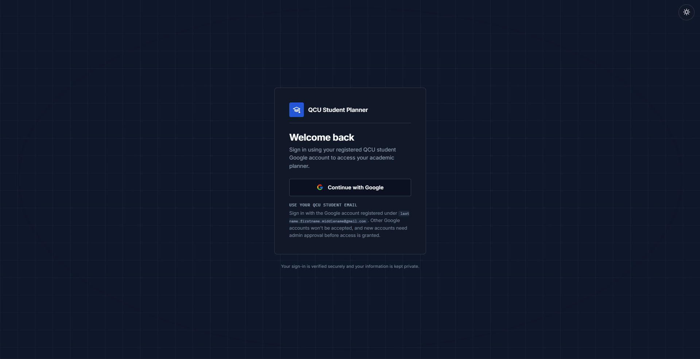

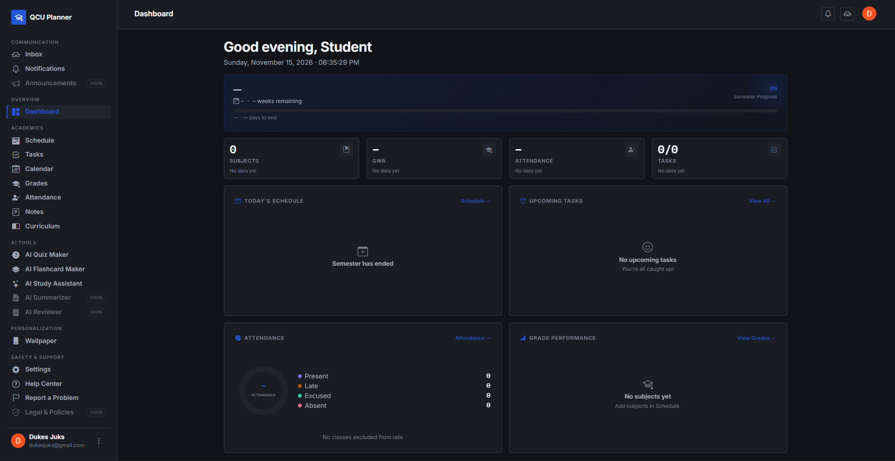

### Planning

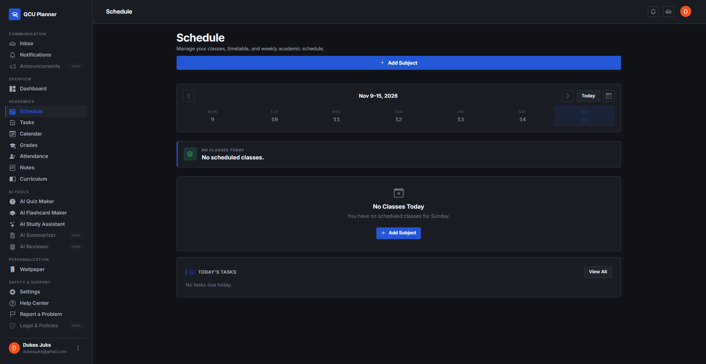

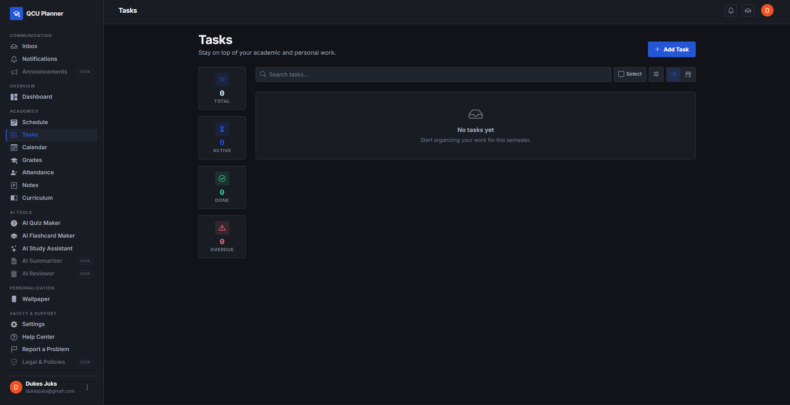

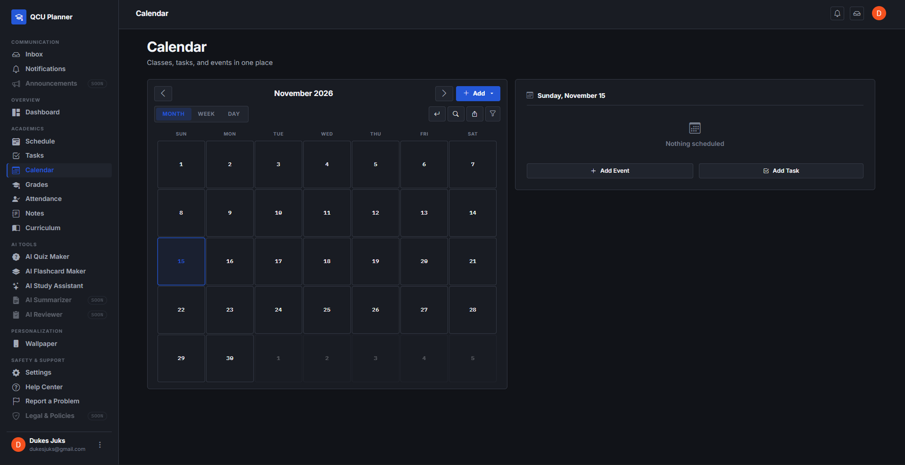

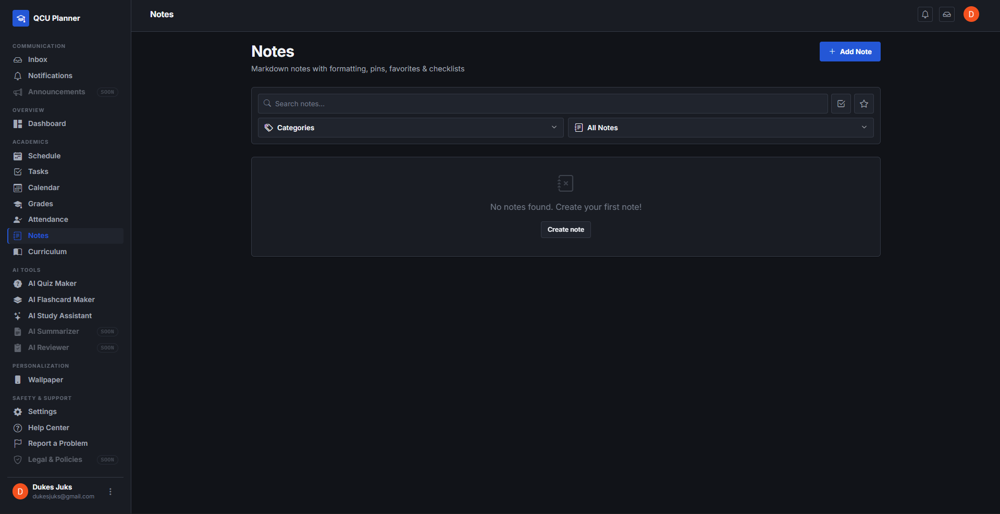

### Grades and attendance

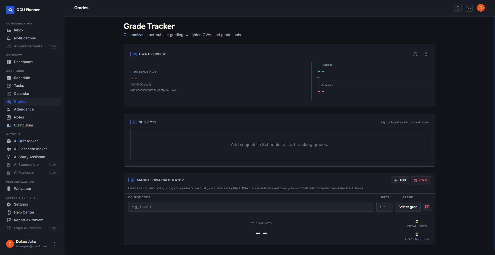

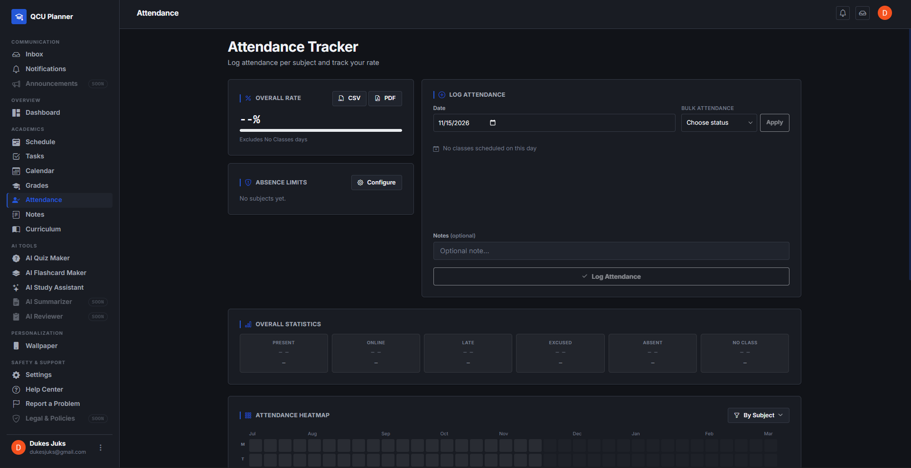

### AI tools

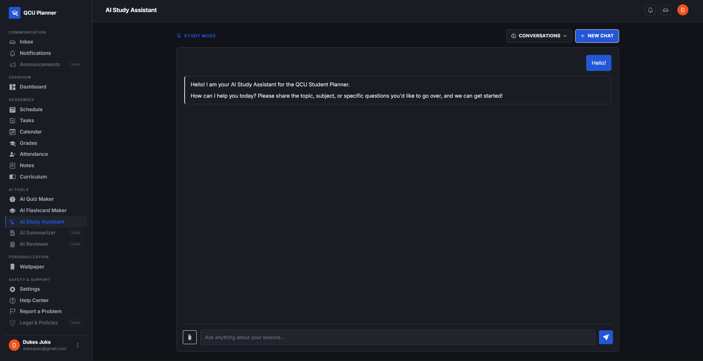

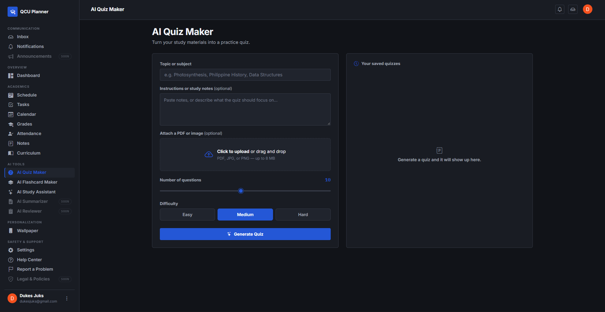

### Mobile

| Dashboard | Schedule | AI Study Assistant |
|---|---|---|
| 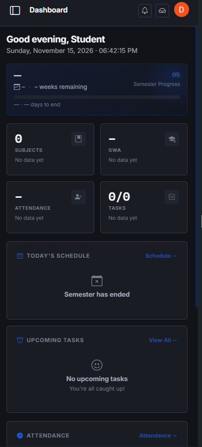 | 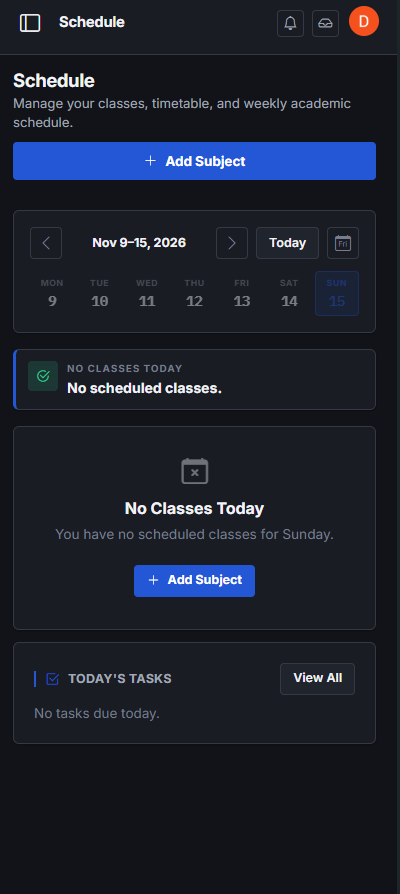 | 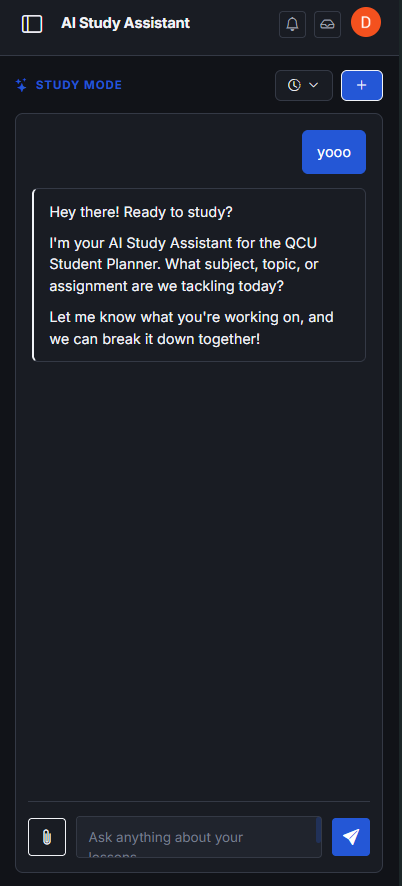 |

## Technology stack

| Technology | How it is used |
|---|---|
| HTML, CSS, JavaScript | The whole frontend. There is no framework and no build step. Student pages (`pages/app/`) load classic scripts. Login and admin pages load ES modules. |
| Bootstrap 5.3.3 | Layout and form basics, loaded from the jsDelivr CDN. Components use the project's own styles. |
| Bootstrap Icons 1.11.3 | Icons across the app, loaded from jsDelivr. |
| Chart.js 4.4.4 | Charts on the admin dashboard, loaded from jsDelivr. |
| PDF.js 3.11.174 | Renders curriculum PDFs in the browser, loaded from cdnjs. |
| Supabase Authentication | Email and password sign-in, Google sign-in, sessions, email confirmation and password reset, through `supabase-js` 2.45.4. |
| Supabase PostgreSQL | Stores profiles, planner data, AI history, messages, support tickets and the audit log. Admin actions run as database functions. |
| Supabase Row Level Security | Limits every table to the signed-in, approved owner, and gives administrators their own access. See [Database and security](#database-and-security). |
| Supabase Edge Functions | `admin-delete-account` deletes rejected accounts. `ai-study` serves the AI tools. |
| Supabase Storage | Hosts the curriculum PDFs in a public `curriculum` bucket. |
| Google Authentication | Google is enabled as a sign-in provider in Supabase. The app starts the flow with `signInWithOAuth` and returns to `pages/auth/callback.html`. |
| Gemini API | Generates AI responses. The frontend never calls Gemini directly. It sends requests to the `ai-study` Edge Function. |
| Vercel | Hosts the static site. `vercel.json` sets redirects, security headers and cache rules. |
| Browser `localStorage` | Holds a device-side copy of your planner data, theme and display settings, and notification read state. |

## Getting started

### Prerequisites

- Git
- Node.js (for `npm start`) or Python 3, to serve the files
- A Supabase project, only if you want your own backend
- The [Supabase CLI](https://supabase.com/docs/guides/cli), only for migrations and Edge Functions
- Google Cloud OAuth credentials, only if you enable Google sign-in on your own project
- A Gemini API key, only if you deploy your own `ai-study` function

There are no packages to install. `package.json` has a `start` script and no dependencies.

### 1. Clone the repository

```bash
git clone https://github.com/MikeyMadeIt/qcu-student-planner.git
cd qcu-student-planner
```

### 2. Run the app locally

```bash
npm start
```

This runs `npx serve .` and prints the local address. Python works too:

```bash
python3 -m http.server 8080
```

Open the address in a browser. `index.html` links to the login page. Service workers and installation need `http://localhost` or HTTPS, so opening files directly with `file://` is not enough.

As committed, `assets/js/core/config.js` points at the project's hosted Supabase backend, so the frontend runs without further setup. Contributors should ask the maintainers which backend to develop against before creating test data.

### 3. Use your own Supabase project (optional)

**Point the frontend at it.** In `assets/js/core/config.js`, replace `supabaseUrl` and `supabaseAnonKey` with your project's URL and anon (public) key. Never put a `service_role` or secret key in any frontend file.

**Add redirect URLs.** In Supabase, open Authentication, then URL Configuration. Set the Site URL and add every origin you use, such as `http://localhost:8080` and your deployed domain. The auth pages that Supabase redirects to are in `pages/auth/`.

**Enable Google sign-in.** In Authentication, then Providers, enable Google and save a Client ID and Client Secret from your Google Cloud project. Add the callback URL shown on that Supabase page to the OAuth client's authorized redirect URIs.

**Apply the database migrations.** The migrations in `supabase/migrations/` (0001 to 0025) must run in numeric order.

```bash
supabase link --project-ref <your-project-ref>
supabase db push
```

You can also paste each file into the Supabase SQL Editor in order. The walkthrough in [`supabase/README.md`](supabase/README.md) covers the early migrations. Later ones explain themselves in their header comments, and [`DATABASE_MIGRATION_REPORT.md`](DATABASE_MIGRATION_REPORT.md) summarizes the ones it covers.

> **A fresh project cannot be built from this repository alone.** No migration creates the core planner tables (`profiles`, `subjects`, `tasks`, `notes`, `calendar_events`, `attendance`, `grades`, `semesters` and related tables) or the AI tables, and no migration defines the AI save functions such as `save_ai_quiz`. They exist only in the live project. To start from scratch, dump the baseline first (for example `supabase db dump --schema public` against the existing project) and apply it before the migrations.

**Deploy the account deletion function.**

```bash
supabase functions deploy admin-delete-account --project-ref <your-project-ref>
```

Then set its secrets in the Supabase dashboard under Edge Functions, then Secrets. The values are listed in the [configuration reference](#configuration-reference), and `supabase/README.md` explains the `SERVICE_ROLE_KEY` setup and the grants in migration 0007.

**Provide an `ai-study` function.** The AI pages call an Edge Function named `ai-study`. Its source is not in this repository, so the AI tools only work on your own project once you deploy a function with that name. It must accept a signed-in user's request and return the response shape below.

```jsonc
// Request body
{
  "feature": "quiz" | "flashcards" | "assistant",
  "prompt": "string, up to 12,000 characters",
  "questionCount": 5,           // quiz only
  "difficulty": "easy",         // quiz only
  "file": { "name": "notes.pdf", "mimeType": "application/pdf", "data": "<base64>" }  // optional
}

// Success
{ "success": true, "result": { } }

// Failure
{ "success": false, "error": "message shown to the student" }
```

The frontend limits attachments to PDF, JPG and PNG files of 8 MB or less. Check `assets/js/services/ai-service.js` and the AI page modules for the `result` shape each feature expects.

**Host the curriculum PDFs.** `assets/js/modules/curriculum.js` links to PDFs in the original project's `curriculum` storage bucket. For your own project, upload the PDFs to a public bucket and update those URLs.

**Create the first administrator.** Administrators are profile rows with role `admin` and status `approved`. The repository has no bootstrap script for the first one.

### Tests

```bash
node --test tests/notes-editor.test.cjs
```

This runs the notes editor tests with Node's built-in test runner. There is nothing to install.

## Project structure

```text
qcu-student-planner/
├── index.html            Entry page that leads to the login page
├── manifest.json         PWA manifest
├── service-worker.js     Service worker (caching rules)
├── vercel.json           Redirects, security headers and cache rules for Vercel
├── package.json          `start` script only, no dependencies
├── pages/
│   ├── auth/             Login, register, verify, pending, callback, finish-profile, forgot and reset password
│   ├── app/              Student pages (dashboard, schedule, tasks, notes, calendar, grades,
│   │                     attendance, curriculum, AI tools, inbox, notifications, report, help,
│   │                     wallpaper, settings, and the coming-soon pages)
│   └── admin/            Admin pages (dashboard, verification, users, rejected, inbox, tickets,
│                         activity-log, and the placeholder pages)
├── assets/
│   ├── css/
│   │   ├── base/         Reset, typography, variables, utilities
│   │   ├── layout/       Grid, sidebar, top bar, navigation drawer, page shell
│   │   ├── components/   Buttons, cards, forms, modals, toasts, calendar, kanban, badges, skeletons
│   │   ├── pages/        One stylesheet per page
│   │   ├── themes/       Light, dark, AMOLED and accent colors
│   │   └── main.css      Stylesheet entry point
│   ├── js/
│   │   ├── core/         Config, Supabase client, page guard, layout and navigation, theme, UI helpers
│   │   │                 (toasts, modals), loading states, PWA registration, Markdown renderer
│   │   ├── data/         localStorage layer, Supabase sync, registration options
│   │   ├── services/     Auth, admin and student services, AI service and stores, GWA and attendance logic
│   │   ├── modules/      One script per page, plus shared admin and messaging helpers
│   │   └── utils/        DOM, dates, validation, sanitizing, auth routing, AI file upload
│   ├── data/             Registration dropdown options (programs, campuses)
│   ├── icons/            PWA icons (regular and maskable)
│   └── images/           Branding, campus and college images
├── supabase/
│   ├── migrations/       Numbered SQL migrations (0001 to 0025)
│   ├── functions/        admin-delete-account Edge Function
│   ├── config.toml       Supabase CLI configuration for local development
│   ├── README.md         Deployment guide for the Supabase side
│   └── SECURITY_VALIDATION.md   Manual security test checklist
├── tests/                Node tests for the notes editor
├── docs/security-audit/  Notes from the data-isolation security audit
└── .github/workflows/    Manual workflow that merges `develop` into member branches
```

## Configuration reference

The app reads no `.env` file. Frontend settings sit in `assets/js/core/config.js`. Server-side secrets live in Supabase and are never committed.

### Public configuration

These are safe to ship in browser code.

| Setting | Location | Purpose |
|---|---|---|
| `supabaseUrl` | `assets/js/core/config.js` | Your Supabase project URL. |
| `supabaseAnonKey` | `assets/js/core/config.js` | The anon (public) key. Access is limited by Row Level Security. |
| `passwordMinLength` | `assets/js/core/config.js` | Minimum password length on the forms (8). |
| `studentEmailPattern` | `assets/js/core/config.js` | Email format that admins see checked on the pending approvals page. |
| `registrationOptionsUrl` | `assets/js/core/config.js` | Path to the registration dropdown data. |

Example, with placeholders:

```js
// assets/js/core/config.js (excerpt)
supabaseUrl: 'https://<your-project-ref>.supabase.co',
supabaseAnonKey: '<your-anon-public-key>',
```

### Secrets

Set these in the Supabase dashboard under Edge Functions, then Secrets. Never put them in a file in this repository.

| Secret | Used by | Notes |
|---|---|---|
| `SERVICE_ROLE_KEY` | `admin-delete-account` | **Secret.** A Supabase secret key with Bypass Row Level Security and Auth user management permissions. Set it by hand. The function reads this name first and falls back to `SUPABASE_SERVICE_ROLE_KEY`. |
| `ALLOWED_ORIGIN` | `admin-delete-account` | Configuration, not a credential. Comma-separated list of origins allowed to call the function from a browser. If unset, browser calls are blocked. |
| `SUPABASE_URL` | `admin-delete-account` | Provided automatically by Supabase. |
| `SUPABASE_ANON_KEY` | `admin-delete-account` | Provided automatically by Supabase. |

Example values, with placeholders:

```text
SERVICE_ROLE_KEY=<your-supabase-secret-key>
ALLOWED_ORIGIN=https://<your-domain>,http://localhost:8080
```

Secrets for the `ai-study` function, such as the Gemini API key, are defined by that function's source, which is not in this repository.

## Database and security

### Architecture

Supabase PostgreSQL stores everything the app saves.

- **Accounts.** `profiles` holds each user's details, `role` and `account_status`.
- **Planner data.** Subjects, tasks, task checklist items, notes, calendar events, cancelled class occurrences, attendance, grades, grade components, grade assessments, the GWA calculator and semesters. `assets/js/data/cloud-sync.js` syncs these with the browser's local copy.
- **AI history.** Quizzes, quiz questions, quiz attempts, flashcard decks, flashcards, chat conversations and chat messages.
- **Administration.** `admin_audit_log`, `admin_messages`, `admin_message_recipients`, `support_tickets` and `support_ticket_notes`.

### Roles and account approval

There are two roles, `student` and `admin`, and four account statuses: `pending`, `approved`, `rejected` and `suspended`.

1. A student registers with email and password or signs in with Google. A database trigger creates the profile.
2. If profile details are missing, the student completes them on the finish-profile page.
3. The account stays `pending` and the student sees the waiting page.
4. An administrator approves or rejects it from Pending approvals. Every status change goes through the `set_account_status` database function and is written to the audit log.
5. Approved students reach the dashboard. Rejected students see the reason, and suspended students are told to contact an administrator.
6. Administrators can later suspend or reactivate an account. A rejected account can be permanently deleted through the `admin-delete-account` function.

### Row Level Security and access limits

- Row Level Security is on for the app's tables. Per-student tables allow access only when `user_id = auth.uid()` and the account is approved (`is_approved()`).
- Administrator features check `is_admin()` in the database. The browser's claim about being an admin is never trusted.
- Triggers revert attempts by a student to change their own `role`, `account_status` or review fields on `profiles`.
- Administrator actions (status changes, sending messages, ticket updates) run through `SECURITY DEFINER` functions. Message recipients are recalculated on the server, so a message can only reach approved students.
- Students can read only their own messages and tickets and cannot reply to a message. Internal ticket notes are visible to administrators only.
- The audit log is append-only. Clients cannot edit or clear it.
- Only the `admin-delete-account` function uses a service-role key. That key stays in the function's server-side secrets.

For the full reasoning and test steps, read [`supabase/SECURITY_VALIDATION.md`](supabase/SECURITY_VALIDATION.md) and [`docs/security-audit/README.md`](docs/security-audit/README.md). The audit notes are a snapshot from one point in time, so check them against the current code before relying on a specific finding.

## Contributing

This section summarizes [`CONTRIBUTING.md`](CONTRIBUTING.md). That file is the source of truth if the two differ.

### Branches

| Branch | Purpose |
|---|---|
| `main` | Stable, production-ready code |
| `develop` | Integration branch for ongoing work |
| `dev/*` | Feature, fix and other working branches |

Name working branches by type: `dev/feature-name`, `dev/fix-name`, `dev/ui-name`, `dev/refactor-name` and `dev/docs-name`. Avoid working directly on `main` or `develop` unless a maintainer has said you can.

### Workflow

```bash
git checkout develop
git pull origin develop
git checkout -b dev/your-feature-name
# make your changes, then commit
git push -u origin dev/your-feature-name
```

Open a pull request with `develop` as the base branch.

### Commit messages

Use the `type: short description` format. The types in use are `feat`, `fix`, `ui`, `style`, `refactor`, `docs`, `chore`, `perf` and `test`. For example: `feat: add task filtering`.

### Pull requests

A pull request should have a clear title, explain what changed and why, reference the related issue or task, and include screenshots for significant UI changes. It should mention any database migrations or configuration changes, list known limitations, and keep unrelated changes out. `CONTRIBUTING.md` has the full checklist.

### Code quality and testing

- Follow the existing structure, naming and design system, and reuse existing components and utilities.
- Handle errors in authentication, database and API code.
- Respect Row Level Security. Never bypass authorization checks or expose service-role keys.
- Make database changes through migration files.
- Test the affected feature on mobile and desktop and check the browser console for errors.
- Run `node --test tests/notes-editor.test.cjs` when you change the notes editor. Other features are checked by hand.
- Do not commit credentials, tokens or other sensitive information.

### Issues

Report bugs and suggest features in [GitHub Issues](https://github.com/MikeyMadeIt/qcu-student-planner/issues). For a bug, include what happened, the steps to reproduce it, what you expected, what you saw instead, your browser or device, and screenshots when they help. Search existing issues first. Discuss major changes with the maintainers before you start.

## Deployment

The site is static and has no build step, so no build command is needed. It is deployed on Vercel, and the repository root is the site root. `vercel.json` provides:

- Redirects from older page URLs such as `/tasks.html` to `/pages/app/tasks.html`.
- Security headers: Content Security Policy, HSTS, `X-Frame-Options: DENY`, `X-Content-Type-Options` and a referrer policy. The Content Security Policy allows scripts and styles from `cdn.jsdelivr.net` and connections to `*.supabase.co`.
- Cache rules: the service worker is always revalidated, and auth, student and admin pages are not stored by caches.

After deploying, complete these steps:

1. Add the deployed origin to the Supabase Site URL and redirect URLs (Authentication, then URL Configuration).
2. Add the same origin to the `ALLOWED_ORIGIN` secret of `admin-delete-account`. Use commas to separate more than one origin, such as production and a preview URL.
3. Confirm that Google sign-in is enabled in Supabase. Google sends users back to the Supabase callback, so no extra Google setting is needed for a new domain.
4. If you add a script, stylesheet, font or API host, add it to the Content Security Policy in `vercel.json`, or the browser will block it.

Do not add keys or secrets to any deployed file or to `vercel.json`.

## Known limitations

- No migration creates the core planner or AI tables, so a new Supabase project needs a baseline schema first (see [Getting started](#3-use-your-own-supabase-project-optional)).
- The `ai-study` Edge Function is not in the repository.
- Test coverage is limited to the notes editor. There is no automated test pipeline.
- Student pages use classic scripts and the login and admin pages use ES modules. Do not change a page's script style without checking every file that depends on its globals.
- The migration walkthrough in `supabase/README.md` covers the early migrations only.
- The root-level audit reports (`CODEBASE_AUDIT_REPORT.md`, `DATABASE_MIGRATION_REPORT.md`, `FINAL_AUDIT_REPORT.md`, `SECURITY_AUDIT.md`) are snapshots from when they were written. Re-run their checks after significant changes.

## Additional documentation

- [Contributing guidelines](CONTRIBUTING.md)
- [Code of conduct](CODE_OF_CONDUCT.md)
- [Security policy](SECURITY.md)
- [Accessibility](ACCESSIBILITY.md)
- [License](LICENSE)
- [Supabase deployment guide](supabase/README.md)
- [Supabase security validation checklist](supabase/SECURITY_VALIDATION.md)
- [Data-isolation security audit](docs/security-audit/README.md)
- [GitHub Issues](https://github.com/MikeyMadeIt/qcu-student-planner/issues)

## Disclaimer

QCU Student Planner is an independent student-developed project and is not an official system of or affiliated with Quezon City University (QCU). The application is designed to assist students with academic organization, planning, and productivity. It is not a substitute for official university services, announcements, or academic records.

## License

Released under the [MIT License](LICENSE).